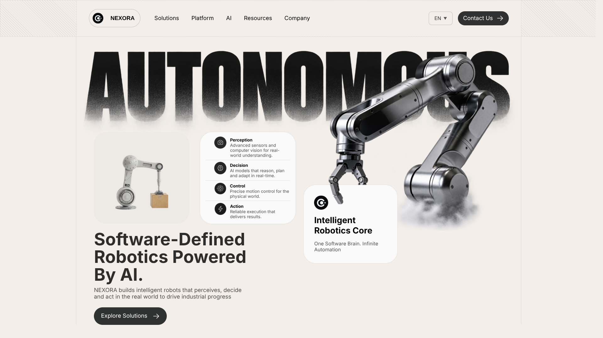

# Nexora

### Autonomous, software-defined robotics powered by AI 🤖

🌐 Demo: [Nexora](https://itstonywhite.github.io/Nexora/)



#### Built with: [React JS](https://react.dev)


---

### 📦 Installation Guide

Follow these steps to set up the project on your local machine:

1. Clone the repository:

```bash
git clone https://github.com/itstonywhite/Nexora.git
```

2. Navigate to the project directory:

```bash
cd Nexora
```

3. Install dependencies:

```bash
npm i
```

4. Start the development server:

```bash
npm run dev
```

5. Open it in your browser:

```
http://localhost:5000/Nexora/
```

---

_This is my very first project with React JS after just 2 days of learning :)_

\- [Tony White](https://github.com/itstonywhite) ✍️
